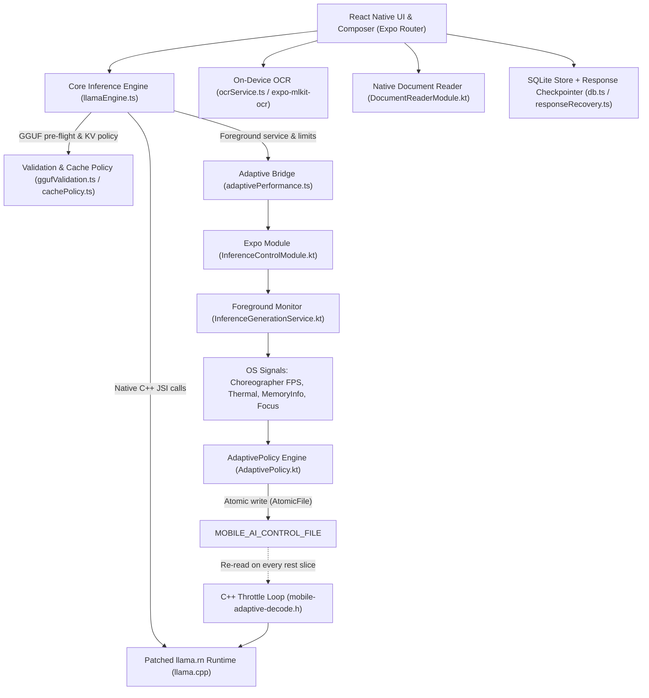
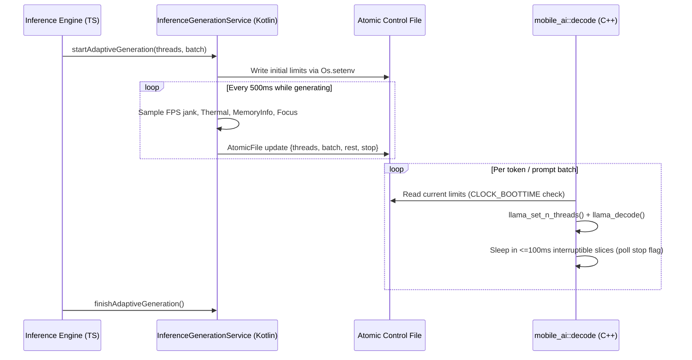

# LocalAI Mobile — System Architecture

This document outlines the internal runtime, native Android modules, C++ thermal/memory throttling loop, crash-safe persistence, and Expo SDK 52 build pipeline powering **LocalAI Mobile**.

---

## High-Level Runtime Architecture

---

## 1. Adaptive C++ Duty-Cycle Throttling (`llama.rn` + `InferenceControl`)

Standard `llama.cpp` mobile bindings run tight CPU loops at maximum thread priority. On mobile hardware, sustained 100% core saturation triggers:
1. UI thread starvation (dropped frames and frozen gestures).
2. Rapid SoC thermal throttling (`PowerManager` throttling down clocks).
3. Android Low Memory Killer (`LMK`) process termination during multitasking.

LocalAI Mobile solves this with a closed feedback loop spanning **Kotlin OS telemetry** and a **C++ decode wrapper** injected into `llama.rn` at prebuild time:

### OS Telemetry & Policy Engine (Kotlin)
* **`InferenceGenerationService.kt`** runs as an Android foreground service (`FOREGROUND_SERVICE_TYPE_SPECIAL_USE` on Android 14+/API 34+) with a partial wake lock and persistent Stop notification (`STOP_ACTION`).
* Every **500 ms** on a dedicated `HandlerThread`, it evaluates:
  * **Frame Jank (`FrameHealth.kt`)**: Attaches a `Choreographer.FrameCallback` tracking delayed frames relative to the active display refresh rate (`30–240 Hz`).
  * **Thermal State**: Reads `PowerManager.currentThermalStatus` (API 29+) and `isPowerSaveMode`.
  * **Memory Pressure**: Reads `ActivityManager.MemoryInfo` (`lowMemory`, `threshold`, `availMem`).
  * **Window Focus**: Tracks whether the app is actively focused or backgrounded/multitasking.
* **`AdaptivePolicy.kt`** computes safe runtime limits (`threads`, `batch`, `restPercent`, `mode`) across graduated states (`Responsive`, `Balanced`, `Keeping phone responsive`, `Multitasking`, `Cooling / memory pressure`, `Protecting phone`, `Recovering`) and writes them atomically (`AtomicFile`) to `MOBILE_AI_CONTROL_FILE`.

### Cooperative C++ Decode Loop (`mobile-adaptive-decode.h`)
Injected into `llama.rn` (`rn-completion.cpp`, `rn-slot-manager.cpp`, `rn-llama.cpp`) by `plugins/adaptiveNativePatch.cjs`:
* Sets `GGML_SCHED_PRIO_LOW` and `poll = 0` on Android `cpuparams` so worker threads yield cleanly to system/UI threads.
* Reads `MOBILE_AI_CONTROL_FILE` via `CLOCK_BOOTTIME` (reverting to conservative fallback limits—`threads=1, batch=8, rest=80%`—if the control file is stale by more than `5000 ms`).
* Clamps batch sizes (`1–32`) and thread counts (`1–8`), measures native `llama_decode()` work time, and rests cooperatively in `<= 100 ms` interruptible slices (`worked * rest / (100 - rest)`, capped at `5000 ms`). Because every rest slice re-reads the control file, toggling Quick Settings, switching apps, or tapping **Stop** takes effect mid-response.

---

## 2. Defensive Model Loading & KV Cache Selection

Loading arbitrary GGUF files on consumer phones requires strict pre-flight validation and OOM fallback handling (`src/core/llamaEngine.ts`, `src/services/ggufValidation.ts`, `src/core/cachePolicy.ts`):

* **GGUF Verification (`validateGGUFFile`)**: Checks file existence, minimum byte length (`>= 24` bytes), exact HTTP byte length when supplied by a controlled download, and the `GGUF` magic header (`R0dVRg==` in Base64) before allocating native memory.
* **Architecture-Aware KV Cache (`selectCache`)**: Inspects GGUF `general.architecture` metadata. Enables compact key caching (`q8_0` keys with `f16` values) strictly for verified attention layouts (`llama`, `qwen2`, `qwen2moe`, `qwen3`, `qwen3moe`, `mistral`) whose key dimensions are `>= 32` and divisible by `32`; retains standard `f16` caches for hybrid/recurrent or unverified layouts.
* **4-Tier OOM Fallback Ladder**: If `initLlama()` fails under device memory pressure (using `use_mmap: true`, `use_mlock: false`), the engine releases partial native allocations via `releaseAllLlama()` and retries progressively down to `f16` cache, `n_ctx <= 512`, `n_batch <= 8`, and `threads = 1`.
* **Degenerate Loop Circuit Breaker**: Monitors a sliding window (`recentTokens`) during token callbacks and aborts cleanly if an identical non-trivial token repeats 12 consecutive times.

---

## 3. Crash-Safe SQLite Persistence & Response Recovery

Mobile OSes can suspend or kill background processes mid-stream. `src/services/db.ts` and `src/core/responseRecovery.ts` prevent silent message corruption:

* **SQLite WAL Configuration**: Opens `qwerty_mobile.db` with `PRAGMA journal_mode = WAL`, `PRAGMA foreign_keys = ON`, `PRAGMA synchronous = NORMAL`, composite `(chat_id, timestamp)` indexing, and full-text chat search (`initializeChatSearch`).
* **Coalesced Checkpointing (`ResponseCheckpointer`)**: Debounces streaming updates every **2000 ms** into `response_checkpoints`, guaranteeing at most one SQLite write in flight so token generation is never I/O-bound.
* **Idempotent Recovery (`recoverResponses`)**: On app startup, replays incomplete checkpoints inside `db.withExclusiveTransactionAsync`. Interrupted retry branches are isolated into `recovered-<id>` sessions rather than overwriting the original conversation thread.

---

## 4. Hardened Document & OCR Extraction

Local file parsing runs offline via `modules/document-reader` (`DocumentTextReader.kt`) and `src/core/ocrService.ts`:

* **Image Probing (`imageSize`)**: Caps cached images at `10 MB` and decodes dimensions with `BitmapFactory.Options().inJustDecodeBounds = true` so oversized images are validated without allocating full bitmaps alongside an active LLM.
* **Disk-Backed PDF Stripping**: Uses PDFBox Android with `MemoryUsageSetting.setupTempFileOnly()`, rejecting encrypted/locked PDFs and enforcing bounds of **64 pages** and **25,000 extracted characters** via a `BoundedWriter`.
* **Hardened DOCX Parser**: Extracts `word/document.xml` using `XmlPullParser` wrapped in a `BoundedInput` stream (`2 MB` decompressed limit) while explicitly rejecting `XmlPullParser.DOCDECL` to prevent XML entity expansion (`XXE` / billion-laughs) attacks.
* **Camera & Photo OCR**: Executes locally through `expo-mlkit-ocr` with capability checks (`isSupported()`) and the same `25,000`-character prompt safety ceiling.

---

## 5. Automated Expo SDK 52 Prebuild Pipeline

`plugins/withAndroidConfig.cjs` automates all native wiring during `npx expo prebuild` so developers do not hand-maintain `android/` build files:

* Applies the idempotent `llama.rn` `0.13.0-rc.4` C++ patch (`patchAdaptiveNative`) and verifies `rnllamaBuildFromSource=true` at Gradle `afterEvaluate` time so unpatched prebuilt binaries cannot accidentally ship.
* Migrates `expo-mlkit-ocr/android/build.gradle` to Expo SDK 52's `ExpoModulesCorePlugin.gradle` helpers (`applyKotlinExpoModulesCorePlugin()`, `useCoreDependencies()`, `useDefaultAndroidSdkVersions()`).
* Clears `debuggableVariants = []` so standalone debug APKs embed JS/assets offline without needing a Metro bundler, while enforcing explicit release signing configuration for production packaging tasks.
