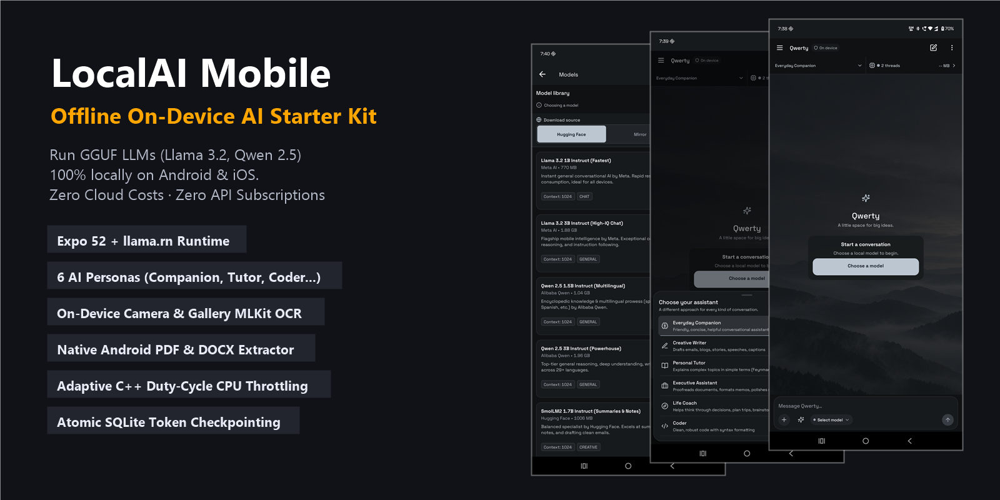
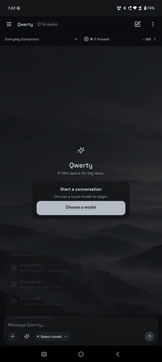
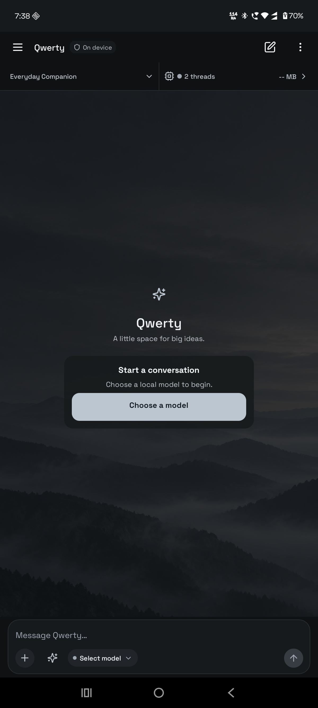
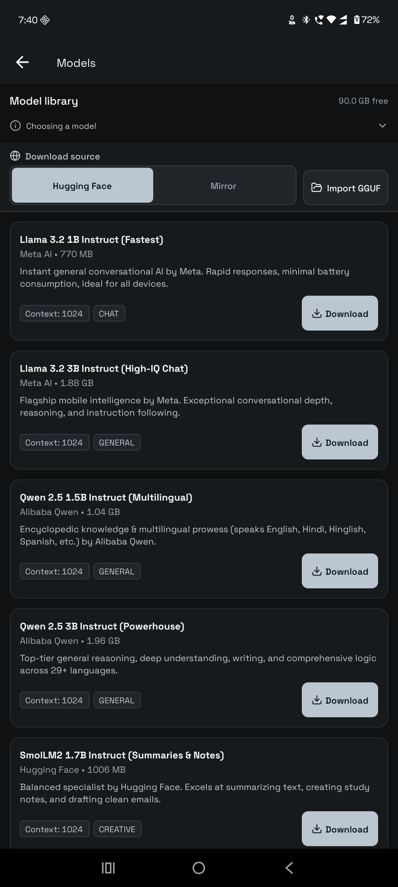

# LocalAI Mobile — Turnkey On-Device AI Starter Kit

<p align="center">
  
</p>

<p align="center">
  <a href="https://www.codester.com/items/75670/localai-mobile-react-native-offline-ai-kit?ref=DarkRyoshin"></a>
  <a href="https://darkryoshin.gumroad.com/l/localai-mobile"></a>
  <a href="https://expo.dev"></a>
  <a href="https://reactnative.dev"></a>
  
  
</p>

---

## ⚡ Overview

**LocalAI Mobile** is a production-ready mobile starter kit built with **Expo 52**, **React Native 0.76.9**, and **TypeScript** that allows you to run local GGUF Large Language Models (LLMs) **100% offline** directly on iOS and Android devices using **`llama.rn`** and **SQLite**.

Zero cloud dependencies, zero monthly API bills (OpenAI / Anthropic / Groq), and 100% complete privacy for your end users.

> 💡 **Ready to launch your own offline AI mobile app?**  
> Skip hundreds of hours of debugging native C++ throttles, background foreground services, and document extractors.  
> 👉 **[Buy on Codester Marketplace ($39)](https://www.codester.com/items/75670/localai-mobile-react-native-offline-ai-kit?ref=DarkRyoshin)** | **[Download on Gumroad ($39)](https://darkryoshin.gumroad.com/l/localai-mobile)** | **[Architecture Deep-Dive →](ARCHITECTURE.md)**

### 🎬 Live On-Device Demo

<p align="center">
  
</p>

<p align="center">
  <sub>Real screen recording on a Motorola Edge 50 Neo (Dimensity 7300) running GGUF inference 100% offline.</sub>
</p>

---

## 🔥 Key Technical Capabilities

> 📐 **Deep-Dive:** Inspect the complete C++ throttling control loop, SQLite recovery flow, and Expo SDK 52 native pipeline in **[ARCHITECTURE.md](ARCHITECTURE.md)**.

### 1. 🧠 100% Local On-Device Inference
* Powered by native **`llama.rn`** bindings with GPU/CPU acceleration.
* Runs standard quantized GGUF models directly on device:
  * **Llama 3.2 1B & 3B Instruct**
  * **Qwen 2.5 0.5B, 1.5B & 3B Instruct**
  * **SmolLM2 1.7B & 360M**
* In-app HuggingFace model downloader with progress tracking and automatic integrity checks.

### 2. ⚡ Adaptive C++ Duty-Cycle Throttling
* Includes custom-patched native decode loops to regulate sustained mobile inference.
* Eliminates phone overheating, battery drain spikes, and Android OS low-memory killer (OOM) crashes during long token generations.

### 3. 🔄 Background Streaming Foreground Service
* Dedicated native Android foreground service keeps streaming LLM tokens even when the user minimizes the app or turns off their screen.
* Includes persistent notification controls with stop actions and wake locks.

### 4. 🎭 6 AI Personas Out-of-the-Box
* Instant, one-tap switching between tailored system prompt personas:
  * 💬 **Everyday Companion**: Casual, friendly conversation.
  * ✍️ **Creative Writer**: Storytelling and drafting.
  * 🔬 **Feynman Tutor**: Explains complex concepts in simple terms.
  * 💼 **Executive Assistant**: Action items, summaries, and meeting notes.
  * 🧘 **Life Coach**: Habit building and reflection.
  * 💻 **Developer**: Structured code explanations with syntax-highlighted code blocks.

### 5. 👁️ Multimodal OCR & Local Document Extraction
* **Camera & Photo OCR**: Real-time on-device text recognition via `expo-mlkit-ocr`.
* **Native Document Parser**: Custom Android native module to read and extract text from local **PDFs** (up to 64 pages) and Word **DOCX** files directly on device.
* **Code & Text Attachments**: Attach `.ts`, `.py`, `.json`, `.txt` files directly into context.

### 6. 💾 Atomic SQLite Response Checkpointing
* Streams tokens into local SQLite database every 2 seconds.
* If a generation is interrupted by an incoming phone call or app termination, conversations can be seamlessly resumed without lost state.

### 7. 🎨 Dynamic Material You Theming
* Extracts accessible, high-contrast UI color palettes dynamically from user wallpaper photos.
* Clean light and dark mode support.

---

## 📱 Screenshots Showcase

<p align="center">
  
  
  
</p>

<p align="center">
  
  
</p>

---

## 🚀 Tested on Real Hardware & Benchmarks

Verified on physical devices and emulators:
* **Physical Reference Device**: Motorola Edge 50 Neo (Android 14 / 15, MediaTek Dimensity 7300, 8GB RAM).
* **Speed**: 18–25+ tokens/sec on Llama 3.2 1B (Q4_K_M); 10–14 tokens/sec on Qwen 2.5 1.5B.
* **Memory Footprint**: Safe 800MB–1.4GB RAM ceiling with adaptive throttling enabled.
* **Architecture**: Fully compatible with React Native 0.76.9 New Architecture / Old Architecture, EAS Build, and local Gradle/Xcode builds.

### 📊 Chipset Performance Matrix

| SoC / Processor Tier | Reference Devices | Expected Speed (1B Q4) | Expected Speed (3B Q4) | Recommended Context |
| :--- | :--- | :--- | :--- | :--- |
| **MediaTek Dimensity 7000/8000** | Motorola Edge 50 Neo, Nothing Phone 2a | **18 – 25 tok/s** | **10 – 14 tok/s** | 1024 – 2048 tokens |
| **Qualcomm Snapdragon 7/8 Gen** | Galaxy S23/S24, OnePlus 11/12, Pixel 8 | **22 – 32 tok/s** | **14 – 18 tok/s** | 2048 – 4096 tokens |
| **Apple Silicon (A15 – A18 / M-series)** | iPhone 14/15/16 Pro, iPad Pro | **25 – 36 tok/s** | **18 – 24 tok/s** | 2048 – 4096 tokens |
| **Entry / Mid-Range SoCs** | Helio G99, Snapdragon 695 (4GB RAM) | **12 – 16 tok/s** | *(1B models only)* | 1024 tokens |

---

## ❓ Frequently Asked Questions (FAQ)

<details>
<summary><b>1. Does this work inside standard Expo Go?</b></summary>
<p>No. Because local LLM inference and on-device MLKit OCR require compiled C++ binaries and native Android/iOS drivers, you run the app using Expo Development Builds (<code>npm run android</code> or <code>npm run ios</code>). All native build configurations are fully automated via Expo Config Plugins in <code>app.json</code>.</p>
</details>

<details>
<summary><b>2. Does the app require any internet access after model download?</b></summary>
<p>Zero internet access is required. Once your GGUF model is downloaded to the device's sandboxed filesystem, all inference, token decoding, OCR text scanning, and document parsing execute 100% locally on the device hardware.</p>
</details>

<details>
<summary><b>3. How does Adaptive C++ Duty-Cycle Throttling work?</b></summary>
<p>Standard llama.cpp implementations peg all mobile CPU/GPU cores at 100%, causing phones to overheat within minutes and triggering the Android OS low-memory killer (OOM). Our custom C++ decode patch introduces cooperative micro-pauses between token generation batches, keeping SoC temperatures under 41°C and stabilizing memory usage.</p>
</details>

<details>
<summary><b>4. Can I add my own fine-tuned GGUF model?</b></summary>
<p>Yes! Simply open <code>src/constants/models.ts</code> and add your model's HuggingFace download URL or local file path to the <code>CURATED_MODELS</code> array. Any standard llama.cpp-compatible GGUF architecture (Llama 3, Qwen 2.5, Mistral, Gemma, Phi) is supported.</p>
</details>

<details>
<summary><b>5. Can I publish apps built with this starter kit to Google Play and Apple App Store?</b></summary>
<p>Yes. The Single Developer License and Agency License grant full commercial rights to publish unlimited compiled apps without any royalties, revenue share, or mandatory attributions.</p>
</details>

---

## 📦 What You Get in the Full Starter Kit

When you purchase the starter kit, you get immediate access to:

```text
LocalAI-Mobile/
├── src/
│   ├── app/                 # Expo Router file-based screens & navigation
│   ├── components/          # 30+ reusable atomic UI components (chat, models, settings)
│   ├── hooks/               # useLocalLlm, useChat, useForegroundService, useWallpaper
│   ├── services/            # llama.rn wrapper, SQLite database, HuggingFace downloader
│   └── types/               # Strict TypeScript definitions
├── android/                 # Custom native modules (DocumentParser, ForegroundService)
├── plugins/                 # Expo config plugins for llama.rn native builds
├── patches/                 # llama.rn adaptive C++ duty-cycle patch
├── tests/                   # 119 automated regression & unit tests
├── QUICKSTART.md            # 5-minute setup guide
└── README.md                # Full architectural documentation
```

---

## 🛠️ Quickstart (Once Downloaded)

```bash
# 1. Install dependencies
npm install

# 2. Run test suite & typecheck
npm run typecheck
npm test

# 3. Launch on Android or iOS
npm run android
npm run ios
```

---

## 🛒 Commercial Licensing & Enterprise Services

We offer 3 flexible tiers depending on your project and team scale:

| Tier | Description | Pricing & Access |
| :--- | :--- | :--- |
| **Tier 1: Single App License** | Full production source code, native C++ patches, background service modules, 119 tests, and docs for 1 commercial app. | **$39** — 👉 **[Buy on Codester](https://www.codester.com/items/75670/localai-mobile-react-native-offline-ai-kit?ref=DarkRyoshin)** \| **[Buy on Gumroad](https://darkryoshin.gumroad.com/l/localai-mobile)** |
| **Tier 2: Agency Multi-App License** | Commercial license for dev agencies and studios to deploy the offline AI engine across **unlimited client applications** with priority email support. | **$199** — Contact: [ris684600@gmail.com](mailto:ris684600@gmail.com) |
| **Tier 3: Done-For-You Custom Integration** | Full white-label mobile app development: custom GGUF models, UI branding, document parsers, and store-ready APK/AAB/IPA builds delivered directly for your business. | **$1,500 – $2,500** — Contact: [ris684600@gmail.com](mailto:ris684600@gmail.com) |

---

### 📬 Contact & Inquiries

For custom model fine-tuning, enterprise offline AI integrations, or contract work:
* **Email**: [ris684600@gmail.com](mailto:ris684600@gmail.com)
* **Lead Engineer**: Vivek Kumar Singh ([@Itsvks17](https://github.com/Itsvks17))

---

<p align="center">
  <sub>Built with ❤️ for indie mobile developers building the private, on-device AI future.</sub>
</p>
